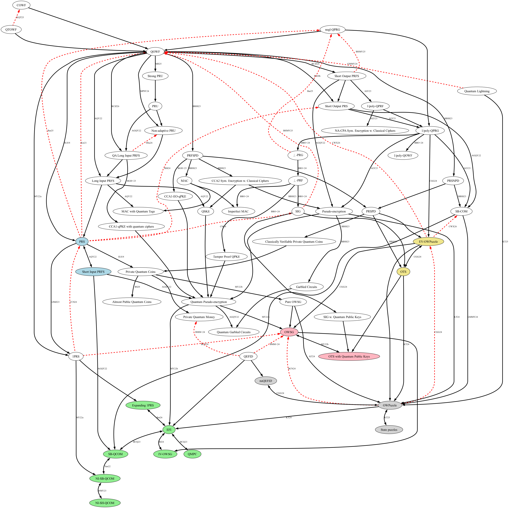

# Microcrypt Zoo
An interactive visualization of known implications and separations between quantum cryptographic primitives that are potentially weaker than one-way functions. Black edges are implications, red dashed edges are separations, double-headed arrows are equivalences, and equivalent primitives are marked with the same color.
**Contributions are welcome!**

View at [sattath.github.io/microcrypt-zoo/](https://sattath.github.io/microcrypt-zoo/).



## For contributors

The main source file is microcrypt.gv, which contains a GraphViz (dot) file, describing all the known relations. To create the graph on your machine, you will need GraphViz installed, then in your terminal:
```bash
./color_by_scc.sh
```
This generates microcrypt.svg (which the web page displays) and microcrypt.png. Don't run `dot` directly: the script also colors equivalent primitives, and plain `dot` output lacks those colors.
Tooltips may contain links written as [label](url), which are shown as links in the info bar.

### What we include
The zoo shows implications between primitives and black-box (or oracle) separations. We only include results that hold without extra restrictions; for example, separations that hold only against adversaries with restricted oracle access, or implications to a weakened variant of a primitive, are not added.

Adding an implication is done by adding to microcrypt.gv one line that contains the reference information, and then a line for the relation itself. For example, Ji, Liu and Song showed that quantum-computable one-way functions imply pseudorandom states:
```dot
edge [label="JLS18" tooltip="Ji, Liu and Song.\n Pseudorandom quantum states.\n CRYPTO18. " URL="https://link.springer.com/chapter/10.1007/978-3-319-96878-0_5"]
QOWF -> PRS;
```

A separation uses the same template, but is written in reverse: "X cannot be black-box constructed from Y" is written `X -> Y` (it is drawn with the arrow pointing from Y to X). For example, Kretschmer showed that QOWF cannot be black-box constructed from PRS:
```dot
edge [label="Kre21" tooltip="Kretschmer.\n Quantum Pseudorandomness and Classical Complexity.\n TQC21. " URL="https://drops.dagstuhl.de/opus/volltexte/2021/13997"]
QOWF -> PRS;
```

### Checklist for adding a result
1. **New primitive?** Declare it at the top of microcrypt.gv with a tooltip giving its full name, e.g. `"Quantum Lightning" [tooltip="Quantum Lightning"];`. Nodes without a declaration have no description on the page.
2. **Where to add the edge:** implications go in the implications section; separations go *after* the line `edge [style=dashed color="red" dir="back"]`, otherwise they are drawn as implications.
3. **Labels** follow the alpha citation style: the first 3 letters of the surname and the year for one author (`Kre21`), initials and the year for 2 to 4 authors (`JLS18`), and the first 3 initials, `+` and the year for 5 or more authors (`CCC+25`). The page sorts a primitive's results by the year in the label.
4. **Equivalences:** add both directions with the same label (the main result, usually the harder direction); they are drawn as one double-headed arrow. Credit other papers inside the tooltip as `[label](url)`. Trivial implications use `label=""`.
5. **Regenerate and commit:** run `./color_by_scc.sh` (needs Graphviz: `brew install graphviz` or `apt install graphviz`) and commit microcrypt.svg and microcrypt.png along with microcrypt.gv, since the site shows the generated SVG.

If you prefer, you can also email me the result (my last name at bgu.ac.il). This repository is maintained by Or Sattath.

Note that the nodes which are in the same strongly connected component are colored the same. This is done using the script color_by_scc.sh (which calls color_by_scc.gvpr). 

## Other contributors
- [Barak Nehoran](https://github.com/bnehoran)
- [Samuel Bouaziz](https://github.com/samuelbouaziz)
- [Matthew Gray](https://github.com/graytmatter)

## Deployment
The site is served by GitHub Pages from the `main` branch, so every push to `main` updates [sattath.github.io/microcrypt-zoo/](https://sattath.github.io/microcrypt-zoo/) within a few minutes.

## Viewing the page locally
Opening index.html directly from disk does not work (browsers block loading microcrypt.svg from a local file). Instead, run a local web server in the repository folder:
```bash
python3 -m http.server
```
and open [http://localhost:8000](http://localhost:8000).
